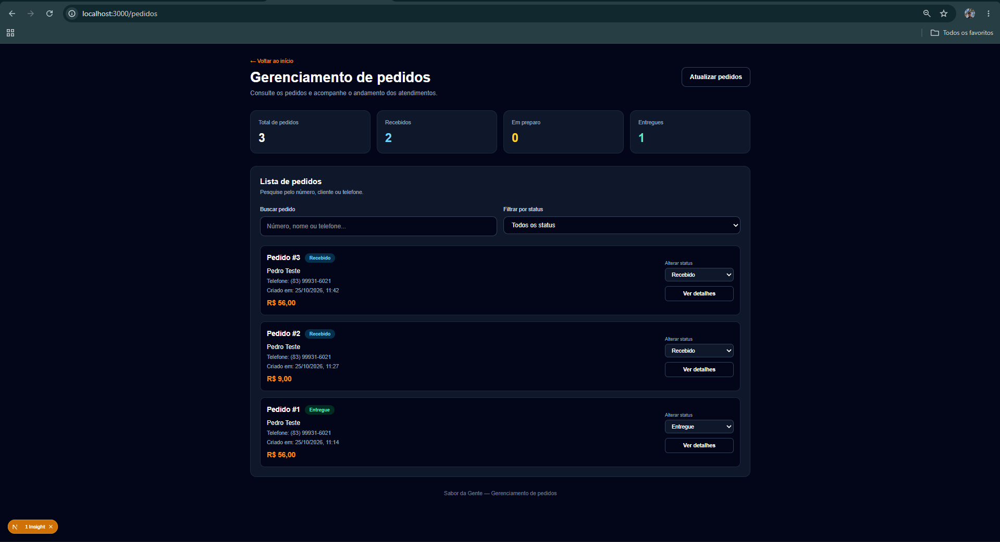
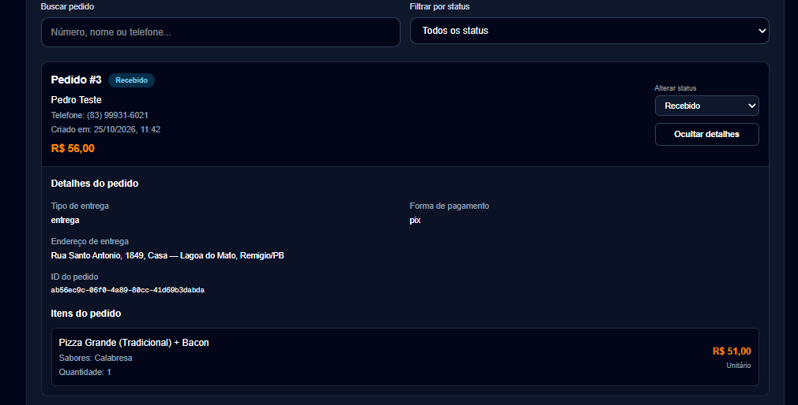
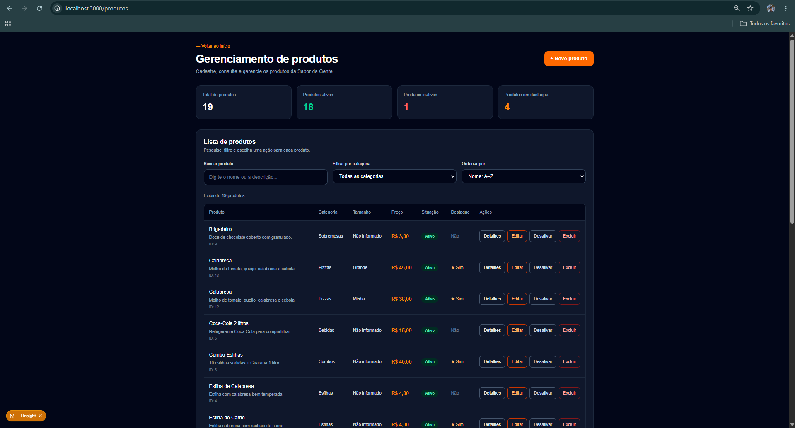
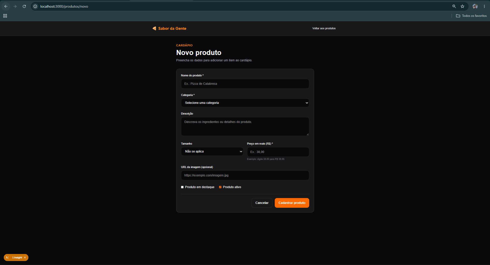

# 🍕 Sabor da Gente — Painel Administrativo Web

Painel administrativo da pizzaria **Sabor da Gente**, feito em **Next.js + React + TypeScript** para a disciplina de **Desenvolvimento de Aplicações Web 3 (DAW III)**.
O cliente faz pedidos pelo app mobile (PDM); a equipe da pizzaria usa este painel. **Os dois conversam pelo mesmo banco, o Supabase.**

## 🎯 Tema

- **Entidade principal:** `Produto` (esfihas, bebidas, combos, sobremesas), com CRUD completo.
- **Entidade secundária:** `Pedido`, vindo do app, com acompanhamento e mudança de status.

Um produto criado, alterado ou desativado aqui aparece no app. Um pedido feito no app aparece aqui, e o status que a pizzaria muda é visto pelo cliente.

## 🛠️ Tecnologias

- Next.js 16 (App Router) e React
- TypeScript e Tailwind CSS
- Supabase (PostgreSQL na nuvem) com `@supabase/supabase-js`

### Por que Supabase
Os dados precisam ser compartilhados com o app mobile e persistir na nuvem. O Supabase entrega PostgreSQL, API pronta e Realtime sem um servidor próprio, e as regras de preço ficam em funções SQL. O banco está no repositório [`api-sabor-da-gente`](https://github.com/Sabor-da-Gente/api-sabor-da-gente).

## ✅ Requisitos funcionais

- [x] **RF01 — CRUD** de produtos (adicionar, listar, editar, excluir, ativar/desativar)
- [x] **RF02 — Persistência** na nuvem (Supabase): os dados continuam após fechar o navegador ou reiniciar o servidor
- [x] **RF03 — Listagem inteligente:** busca, filtros e ordenação
- [x] **RF04 — Validação** dos campos do formulário
- [x] **RF05 — Navegação:** listagem, formulário (novo/editar) e detalhe do produto; lista e detalhes de pedidos
- [x] **RF06 — Feedback:** confirmação de exclusão, mensagens de sucesso/erro e indicadores de carregamento

## 🗂️ Modelo de dados (resumo)

**produtos:** `id`, `categoria_id`, `nome`, `descricao`, `preco` (centavos), `imagem_url`, `destaque`, `ativo`, `criado_em`.

**pedidos:** `id` (uuid), `numero`, `cliente_nome`, `cliente_telefone`, `tipo_entrega`, `endereco_entrega`, `forma_pagamento`, `troco_para`, `subtotal`, `desconto`, `taxa_entrega`, `total`, `status`, `criado_em`.

**itens_pedido:** `id`, `pedido_id`, `nome`, `sabores`, `quantidade`, `preco_unitario`.

Status do pedido: `recebido`, `em_preparo`, `saiu_para_entrega`, `pronto_para_retirada`, `entregue`, `cancelado`.
Modelo completo: [`api-sabor-da-gente`](https://github.com/Sabor-da-Gente/api-sabor-da-gente).

## ▶️ Como executar

    git clone https://github.com/Sabor-da-Gente/sabor--da-gente-web.git
    cd sabor--da-gente-web
    npm install
    npm run dev

Abra http://localhost:3000. O arquivo `.env` já vem no repositório com a URL do projeto e a *publishable key* do Supabase (chave pública; nunca use a *secret key* ou *service_role* aqui).

Páginas: `/` (início), `/produtos`, `/produtos/novo`, `/produtos/[id]`, `/produtos/editar/[id]` e `/pedidos`.

## 📸 Telas

## 🗃️ Organização

    app/        páginas (início, produtos, pedidos)
    lib/        cliente do Supabase (camada de dados)

## 📌 Observação

Projeto acadêmico: o painel não tem login e usa a chave pública, por isso o acesso às tabelas de produtos e pedidos é aberto. Não é uma configuração para produção.
